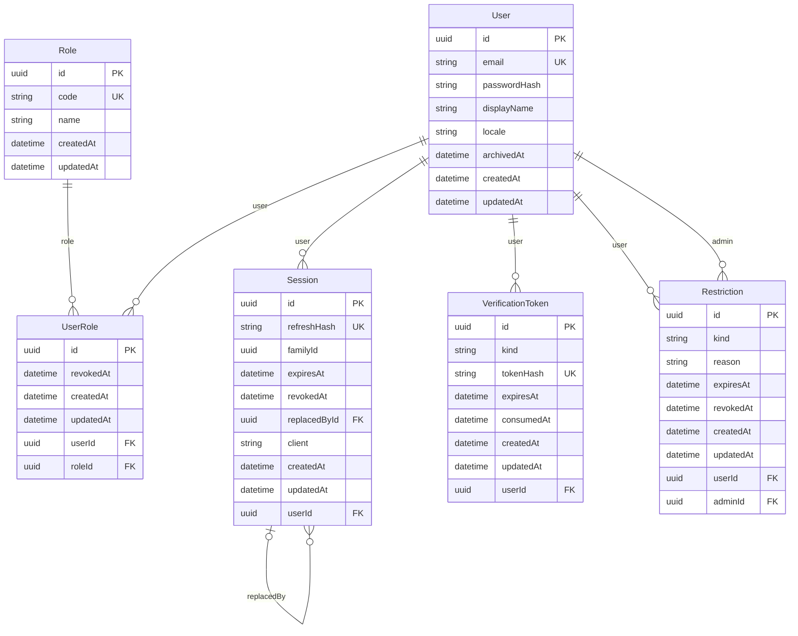
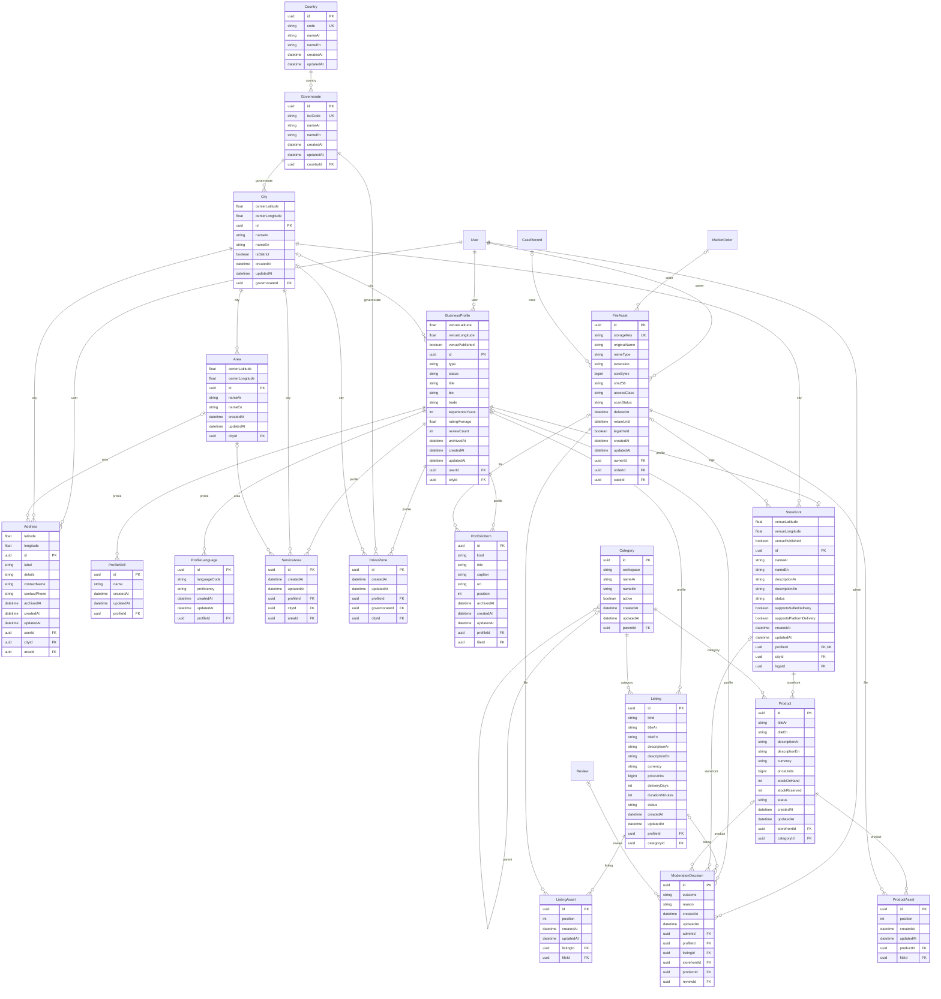
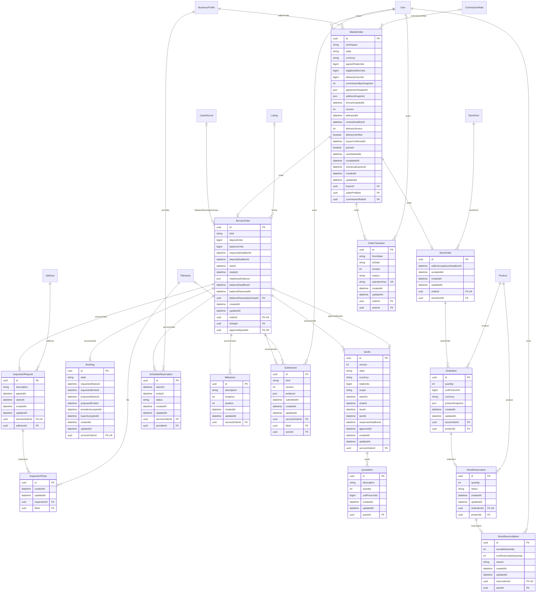
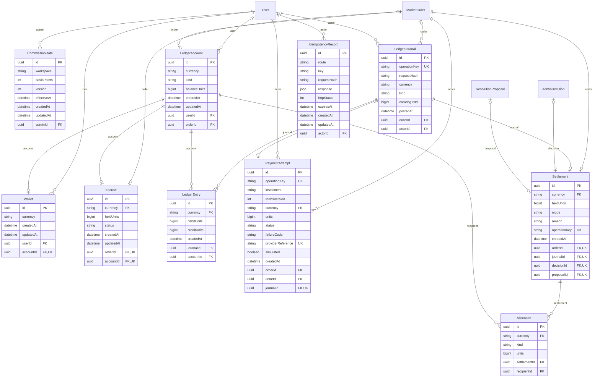
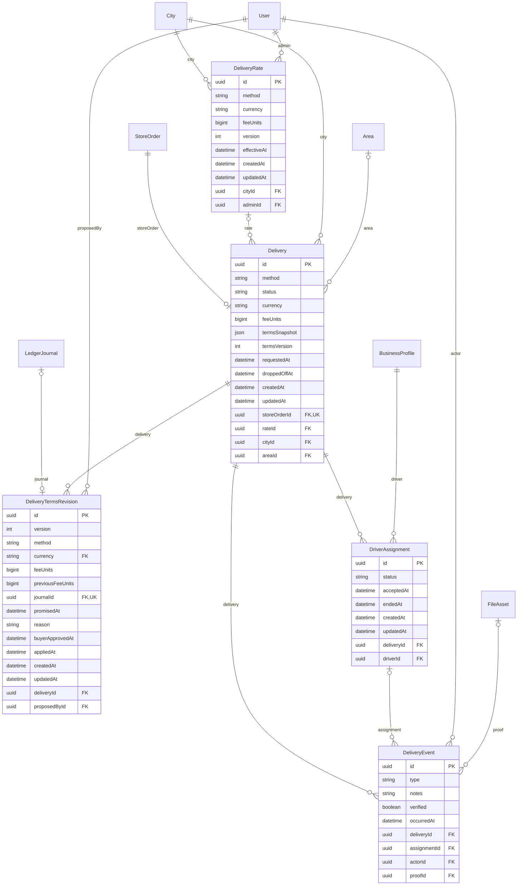
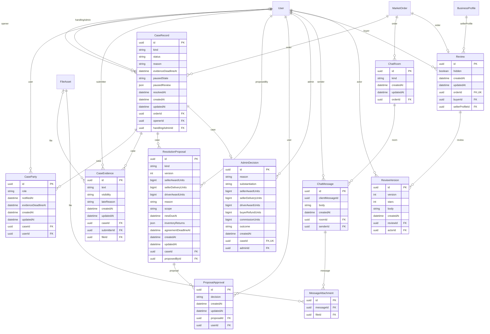
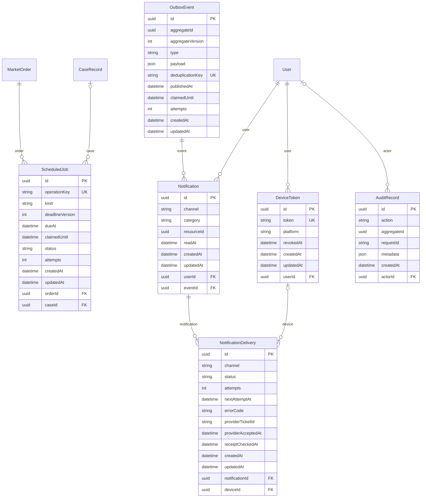

# Implemented relational database design

Generated from the canonical Prisma datamodel by `npm run db:erd`. There are 72 domain models plus the unchanged legacy SetupMetadata table. All domain primary identifiers are PostgreSQL UUIDs with database-generated defaults; Country now has a UUID primary key and unique code. Money is BIGINT stored units (SYP pounds / USD cents), never floating point. LedgerJournal represents a financial transaction; PaymentAttempt represents its simulated provider result.

The schema and migration files are implemented; application against a live PostgreSQL database is a separate validation result in [database and contract report](DATABASE_CONTRACT_REPORT.md). Enum definitions and exact nullability/indexes are authoritative in `backend/prisma/schema.prisma`. PK, FK and UK below are literal datamodel constraints. Every physical relation is shown once, including references crossing diagrams.

## Identity and access

## Geography, profiles and catalog

## Orders, scheduling, quotes and inventory

## Wallets, financial transactions and escrow

## Delivery

## Cases, chat and verified reviews

## Notifications, jobs and audit

## PostgreSQL invariants beyond Prisma notation

The domain_constraints migration supplies partial unique indexes for one active business profile, one active driver assignment, successful installment/adjustment uniqueness, one unresolved financial case, platform/wallet accounts, and nullable global/city-wide scopes. It adds provider/time exclusion with btree_gist; minor-unit, stock, price, review, deadline and geographic parent checks; exact service split and itemized totals; and deferred cross-row integrity checks.

Ledger entries and journals are immutable and must be inserted in one transaction. Entry triggers maintain account and escrow balances; direct balance writes and late journal appends fail. Deferred checks require at least two balanced entries in one currency. Settlement uniqueness, grouped recipient credits, held-unit conservation, snapshotted commission, recipient ownership, case gating and review eligibility are checked before commit. Historical records use RESTRICT rather than cascading deletes.

Database constraints do not replace authenticated backend policies. Transaction-safe financial application commands coordinate holds, inventory, cases, settlement, audit, idempotency and outbox. Cancellation negotiation, revisions, delivery changes, worker scheduling, HTTP controllers and client integration remain subsequent application slices; their contracts are specified now. See [database implementation notes](DATABASE.md) for lock ordering, privileges, migration and seed instructions.
