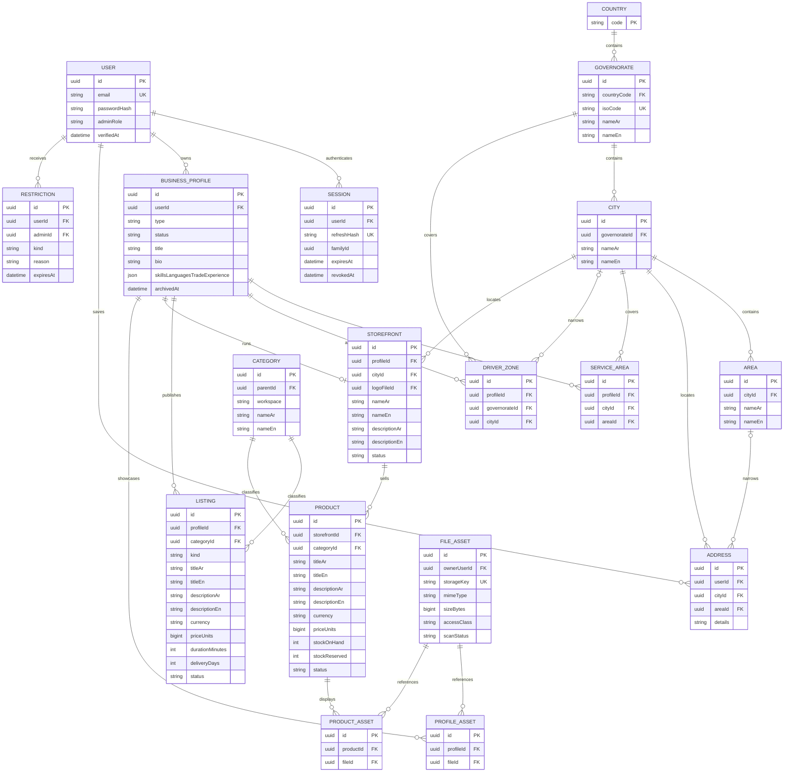
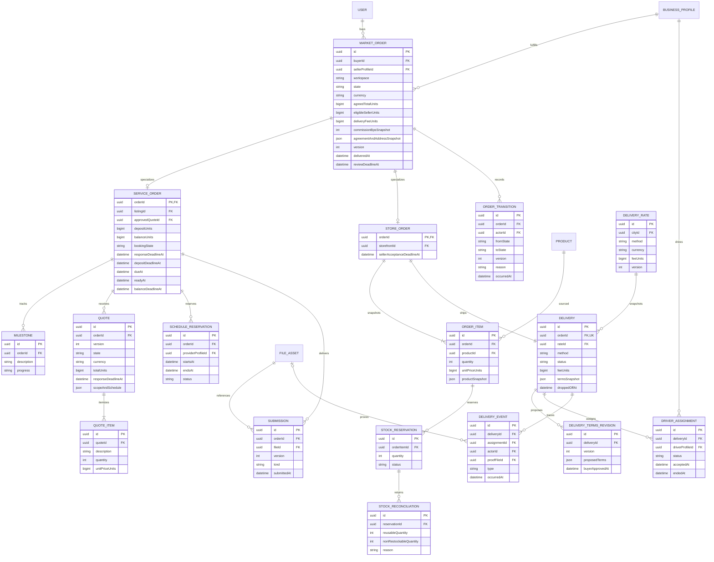

# Intended database design

Conceptual release-one model, not yet a business Prisma schema. UUID primary keys; UTC `timestamptz` timestamps; monetary BIGINTs serialized as strings; integer basis points; currency SYP/USD. FKs below are mandatory unless explicitly optional. `actorId` on audits may be null for system jobs. The foundation migration only creates `SetupMetadata`; all entities below enter reviewed domain migrations in the implementation slices.

## Identity, geography and catalog

`LISTING.kind` distinguishes freelance service and professional fixed package; applicability checks require deliveryDays for freelance and durationMinutes for professional. Store logos/products/portfolio use Files; public derivatives have separate keys. Optional `areaId`, `cityId` on governorate-wide zone, refresh revocation and verification timestamps are nullable. Category parent optional. Admin FKs reference USER. Geography parent consistency is validated and protected by composite FKs where applicable.

## Agreements, orders, stock, schedules and delivery

Final-file SUBMISSION fileId optional for documented on-site handover with structured evidence; actual schema must distinguish evidence fields rather than silently empty submissions. Quote/listing FK optional for custom professional request. `approvedQuoteId` optional and points to an accepted version of the same order. A MARKET_ORDER has exactly one workspace specialization; triggers/checks plus creation transaction enforce it. Delivery proof reference optional deliberately represents unproven physical delivery and blocks auto-release. Delivery assignment/event association optional for seller delivery.

## Money, cases and collaboration

```mermaid
erDiagram
  USER ||--o{ LEDGER_ACCOUNT : owns
  MARKET_ORDER ||--|| ESCROW : secures
  MARKET_ORDER ||--o{ PAYMENT_ATTEMPT : funds
  MARKET_ORDER ||--o| SETTLEMENT : settles
  MARKET_ORDER ||--o{ CASE_RECORD : disputes
  CASE_RECORD ||--o{ CASE_EVIDENCE : receives
  CASE_RECORD ||--o{ RESOLUTION_PROPOSAL : proposes
  CASE_RECORD ||--o| ADMIN_DECISION : decides
  SETTLEMENT ||--|{ ALLOCATION : awards
  LEDGER_JOURNAL ||--|{ LEDGER_ENTRY : balances
  LEDGER_ACCOUNT ||--o{ LEDGER_ENTRY : posts
  SETTLEMENT ||--|| LEDGER_JOURNAL : posts
  PAYMENT_ATTEMPT o|--o| LEDGER_JOURNAL : posts
  MARKET_ORDER ||--|{ CHAT_ROOM : discusses
  CHAT_ROOM ||--o{ CHAT_MESSAGE : contains
  CHAT_MESSAGE ||--o{ MESSAGE_ATTACHMENT : includes
  FILE_ASSET ||--o{ MESSAGE_ATTACHMENT : references
  FILE_ASSET ||--o{ CASE_EVIDENCE : references
  MARKET_ORDER ||--o| REVIEW : verifies
  REVIEW ||--|{ REVIEW_VERSION : preserves
  USER ||--o{ NOTIFICATION : receives
  USER ||--o{ DEVICE_TOKEN : registers
  OUTBOX_EVENT ||--o{ NOTIFICATION : produces
  COMMISSION_RATE {
    uuid id PK
    string workspace
    int basisPoints
    int version
    datetime effectiveAt
    uuid adminId FK
  }
  ESCROW {
    uuid orderId PK,FK
    uuid ledgerAccountId FK,UK
    bigint heldUnits
    string status
  }
  LEDGER_ACCOUNT {
    uuid id PK
    uuid userId FK
    string currency
    string kind
    bigint balanceUnits
  }
  PAYMENT_ATTEMPT {
    uuid id PK
    uuid orderId FK
    uuid actorId FK
    string installment
    string status
    string providerReference UK
    uuid journalId FK
    datetime createdAt
  }
  LEDGER_JOURNAL {
    uuid id PK
    string operationKey UK
    string currency
    string kind
    uuid orderId FK
    datetime postedAt
  }
  LEDGER_ENTRY {
    uuid id PK
    uuid journalId FK
    uuid accountId FK
    bigint debitUnits
    bigint creditUnits
  }
  SETTLEMENT {
    uuid id PK
    uuid orderId FK,UK
    uuid decisionId FK
    uuid journalId FK,UK
    bigint heldUnits
    datetime settledAt
  }
  ALLOCATION {
    uuid id PK
    uuid settlementId FK
    uuid recipientAccountId FK
    string kind
    bigint units
  }
  CASE_RECORD {
    uuid id PK
    uuid orderId FK
    uuid openerId FK
    uuid handlingAdminId FK
    string kind
    string status
    datetime evidenceDeadlineAt
    json pausedReview
  }
  CASE_EVIDENCE {
    uuid id PK
    uuid caseId FK
    uuid submitterId FK
    uuid fileId FK
    string text
    string visibility
    datetime submittedAt
  }
  RESOLUTION_PROPOSAL {
    uuid id PK
    uuid caseId FK
    json allocationOrRevision
    datetime buyerAcceptedAt
    datetime sellerAcceptedAt
    datetime agreementDeadlineAt
  }
  ADMIN_DECISION {
    uuid id PK
    uuid caseId FK,UK
    uuid adminId FK
    string reason
    json substantiationAndAllocations
    datetime decidedAt
  }
  CHAT_ROOM {
    uuid id PK
    uuid orderId FK
    string kind
  }
  CHAT_MESSAGE {
    uuid id PK
    uuid roomId FK
    uuid senderId FK
    string clientMessageId
    string body
    datetime createdAt
  }
  MESSAGE_ATTACHMENT {
    uuid id PK
    uuid messageId FK
    uuid fileId FK
  }
  REVIEW {
    uuid id PK
    uuid orderId FK,UK
    uuid buyerId FK
    uuid sellerProfileId FK
    string moderationStatus
    datetime createdAt
  }
  REVIEW_VERSION {
    uuid id PK
    uuid reviewId FK
    int version
    int stars
    string body
    datetime createdAt
  }
  IDEMPOTENCY_RECORD {
    uuid id PK
    uuid actorId FK
    string route
    string key
    string requestHash
    string status
    json response
    datetime expiresAt
  }
  AUDIT_RECORD {
    uuid id PK
    uuid actorId FK
    string action
    string aggregateId
    string requestId
    json redactedMetadata
    datetime createdAt
  }
  OUTBOX_EVENT {
    uuid id PK
    string aggregateId
    int aggregateVersion
    string type
    json payload
    datetime publishedAt
    int attempts
  }
  SCHEDULED_JOB {
    uuid id PK
    string operationKey UK
    uuid orderId FK
    datetime dueAt
    datetime claimedUntil
    string status
    int attempts
  }
  NOTIFICATION {
    uuid id PK
    uuid userId FK
    uuid eventId FK
    string channel
    datetime readAt
  }
  DEVICE_TOKEN {
    uuid id PK
    uuid userId FK
    string token UK
    string platform
    datetime revokedAt
  }
```

Nullable: LEDGER_ACCOUNT.userId for platform/escrow/clearing accounts; COMMISSION_RATE.workspace for global; commission snapshot until first successful hold; pending/failed attempt journal; admin assignment/decision until resolution; evidence file when text-only; decisionId for consensual completion; sender actor may be system only in audit, not user chat. Commission rate versions preserve changes; MARKET_ORDER snapshots the effective basis points and source version at first hold.

## Required database constraints and indexes before business implementation

- Unique normalized email; one ACTIVE BUSINESS_PROFILE per user; unique user/currency available account and order/currency escrow account; nonnegative available/held quantities. A DB migration adds partial/exclusion/deferrable constraints Prisma cannot express.
- Orders cannot mix currencies: composite account/currency and order/currency references on financial rows. Check positive totals, legal service split and nonnegative components. No floating money. Service total == deposit+balance. Items and quoted delivery sum to agreed total.
- Commission basis points [0,10000], rate scope/version unique; effective global/workspace lookup excludes future versions. Null scope means global, explicit zero is valid.
- One successful hold per `(orderId, installment)` using partial unique index, except explicitly versioned store delivery adjustments; unique provider reference, journal operation key, settlement orderId and journalId. Sum of journal debits == credits per currency enforced by deferred posting validation/constraint trigger; append-only privileges prohibit edits/deletes. Settlement allocations sum exactly to escrow released, with recipient kind and currency validated.
- `stockOnHand >= 0`, `stockReserved >= 0`, reserved <= onHand; unique reservation per order item; reconciliation total <= reservation and one final reconciliation operation. Atomic conditional stock updates; indexes on storefront/category/status/price/geography.
- One active ASSIGNED/PICKED_UP DRIVER_ASSIGNMENT per delivery; indexes on open jobs by city/governorate and state; assigned driver must have eligible active driver profile. Exclusion on provider/time range for active reservations using `btree_gist`.
- Quote `(orderId, version)`, delivery terms `(deliveryId, version)`, transition `(orderId, version)`, message `(roomId, senderId, clientMessageId)`, room `(orderId, kind)`, review orderId, review version, notification `(userId,eventId,channel)` unique. Stars integer 1..5. One unresolved financial case per order; post-settlement support cases are separate and cannot create another SETTLEMENT.
- Idempotency unique `(actorId, route, key)` with request hash. Client request keys kept at least 7 days; permanent financial operation uniqueness never expires. Outbox/jobs indexed on dueAt/publishedAt/claim lease; jobs uniquely keyed by aggregate/timer version. Financial/status update and outbox persist atomically.
- FKs use RESTRICT for order, ledger, proof, review and audit history. Archive/tombstone identity/catalog rather than cascade-delete historical evidence. File retention removes bytes only when allowed, preserving metadata references. Add buyer/seller/state/deadline, account/journal and case/status indexes.
