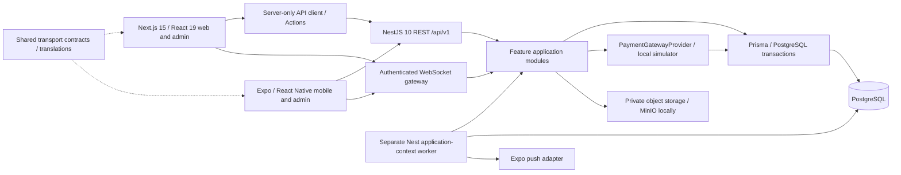

# System design

Status: database schema, migration files, seed and API contracts are now implemented in source; financial persistence commands are internal. Business HTTP/WebSocket handlers, worker scheduling and clients remain future slices. Live database execution evidence is separate. Required release scope comes from requirements revision 1.2; submission requirements come from all nine PDF pages. Stack selected by the owner overrides the source's open technology decision.

## Overview and boundaries

A Syrian buyer needs one account to discover remote work, book local professionals and buy home-produced goods, with trustworthy tracked payment and fulfillment. Three workspaces share identity, geographic data, order communication and a local simulated financial core. Customers, freelancers, professionals, store owners, drivers and admins are actors; business actors also buy. Scope includes both clients and full mobile administration. Live funds, ShamCash Sandbox, cross-currency conversion, multiseller checkout, per-milestone billing, real-time GPS and automatic post-settlement reversal are out of scope.

One deployable API and a separate worker process use the same application modules/database. This is a modular monolith, not distributed business services. Socket.IO provides authenticated room events; durable REST state/outbox remains authoritative. No business logic executes in either client. Deployment keeps API, worker, PostgreSQL and object storage private as appropriate behind HTTPS ingress; web is the public Next server. Mobile targets iOS/Android development builds, later an Expo review link or APK.

## Reference architecture inspection

Inspected the [reference README](https://github.com/b4f-cohort8-salamiyah/b4f-board-final), [Nest module composition](https://raw.githubusercontent.com/b4f-cohort8-salamiyah/b4f-board-final/main/api/src/app.module.ts), and [web manifest](https://raw.githubusercontent.com/b4f-cohort8-salamiyah/b4f-board-final/main/web/package.json). Adopt domain modules, Prisma persistence, DTO validation, Passport/JWT, Swagger, server-only web API access, Server Actions, and narrowly scoped Redux state. Rename the reference's `api/web` roots to B4F's required `backend/frontend`; copy no project-board logic. Browser WebSockets and mobile direct API access are explicit adaptations for this product. Some source paths and direct Git transport were unavailable; deeper implementation reuse is not claimed.

## Feature organization and deployment

Each backend feature will contain transport/DTOs, application commands/queries, domain policies and persistence/adapters as complexity warrants. Avoid empty classes and speculative generic repositories. `common/` contains transport/security primitives only; `infrastructure/` contains config, database, telemetry and storage. Modules export narrow application capabilities. See `MODULE_BOUNDARIES.md` for ownership.

The executable shells expose API health and documentation, a nonprocessing worker heartbeat, and web/mobile setup pages. The current database increment adds the full Prisma model, migration files, development seed, internal simulated financial commands and canonical OpenAPI/WebSocket types in `packages/contracts`. The simulator port stays in its owning backend feature. Business HTTP controllers and client flows are not wired; migrations and seed require a running PostgreSQL server. Contracts are frozen before each client integration slice.

## Three use cases

1. Buyer requests a fixed-price professional slot. Provider accepts or proposes another slot; buyer accepts any change. The server fixes total and schedule, displays terms and 48h timer, holds deposit, tracks en route/on-site work, records readiness, holds balance, records handover, then reviews and settles. A separately approved itemized quote converges on exactly this funded workflow.
2. Buyer checks out from one store in one currency with serviceable address and delivery terms. The transaction reserves stock and holds total. Seller prepares; seller or unique eligible driver records delivery proof. Buyer confirms, or the 72h verified-delivery timer settles once; lack of proof goes to buyer confirmation/admin.
3. Buyer disputes during delivery review. The transaction locks order and escrow, freezes funds and creates evidence deadlines. A racing completion cannot post. Handling admin views authorized evidence and records a substantiated allocation; journal totals exactly match held funds and repeat requests reuse one result.

## Nonfunctional design

- Security: least-privilege guards plus object-level authorization on REST, sockets and downloads; bcrypt, short-lived JWT with rotating refresh, CSRF protection for cookie actions, strict DTO whitelist, upload quarantine. Web tokens stay HttpOnly; mobile refresh credentials use secure OS storage.
- Reliability: durable UTC deadlines, serializable financial transactions, unique operation keys, partial driver assignment index, atomic inventory, outbox, deterministic retries and database-backed worker claims. No exactly-once transport claim; exactly one financial effect is enforced in PostgreSQL.
- Usability: logical spacing and reading order, Arabic/English error translations, accessible forms, progress/deadline displays, visible simulator badge and parity across web/mobile/admin.
- Performance: indexed actor/order/deadline/geography/category queries, cursor pagination, no N+1 file grants, short transactions, bounded event payloads. Targets are in business default D19.
- Maintainability: strict TypeScript, feature ownership, explicit ports, versioned APIs, contract generation, migrations reviewed with constraints, testable clock and financial policies.
- Operations: environment validation, separate readiness from liveness, redacted request IDs, reconciliation queries, backup/restore drills, optional crash/error telemetry after privacy review.

## Security/session details to implement

Access token TTL 15 minutes, refresh 30 days; refresh tokens stored hashed with session family, rotated once and revoked on reuse/password reset/suspension. Web uses Secure/HttpOnly/SameSite cookies in production and trusted Origin/CSRF checks on mutations; server-only API calls use bearer access. Mobile stores refresh token in Expo SecureStore and keeps access token in memory. Never embed shared secrets in `NEXT_PUBLIC_*` or `EXPO_PUBLIC_*`. WebSocket handshake ticket is obtained through authorized web server action, expires in 60 seconds, is single use and includes allowed actor/session; joins still check current order permissions. Mobile may authenticate sockets with short-lived access JWT. Permission revocation closes relevant rooms; event payloads contain IDs and version, then authorized REST refetch. Audit security-sensitive activity without recording tokens.

## Data and race handling

See `ERD.md` for intended entities/constraints and `DATA_FLOW.md` for transactions. Lock participant User rows in sorted UUID order, then the order, then inventory/delivery/schedule resources, then ledger accounts in sorted UUID order; acquire inventory/assignment records consistently. Use SERIALIZABLE and bounded retries with a stable operation key. Acceptance of dispute and settlement have a single serialization point on the order row. Persist the new order version, financial journal, immutable timeline/audit, idempotency outcome and outbox together. A worker only claims work, then rechecks all conditions under the same domain command transaction. Gateway simulation is local and transaction-aware; a future external provider would require a reservation/reconciliation design and is outside this release.

## Configuration and release strategy

Node 22 LTS baseline; npm workspaces and a single lockfile when dependency resolution is available. Backend NestJS 10, Prisma 6/PostgreSQL 16, Swagger/Jest; frontend Next.js 15/React 19/Tailwind 3/Redux Toolkit; Expo SDK 54 pairs React 19.1 with React Native 0.81 ([Expo SDK compatibility](https://expo.dev/sdk/54)). Stay on the owner's major versions and resolve patched versions before deployment; [Next.js security guidance](https://nextjs.org/blog) requires updating its supported maintenance line. The generated dependency lockfile, not a version range alone, is the reproducibility artifact.

Deliver vertical slices on one API: identity/listings -> agreements/holds -> fulfillment -> chat/delivery/disputes/reviews/notifications -> both-client admin -> deployment/submission. No slice removes another required workspace. Environment templates and commands are in the README; implementation and reviewer gates are in `IMPLEMENTATION_PLAN.md` and `SUBMISSION_GUIDE.md`.
